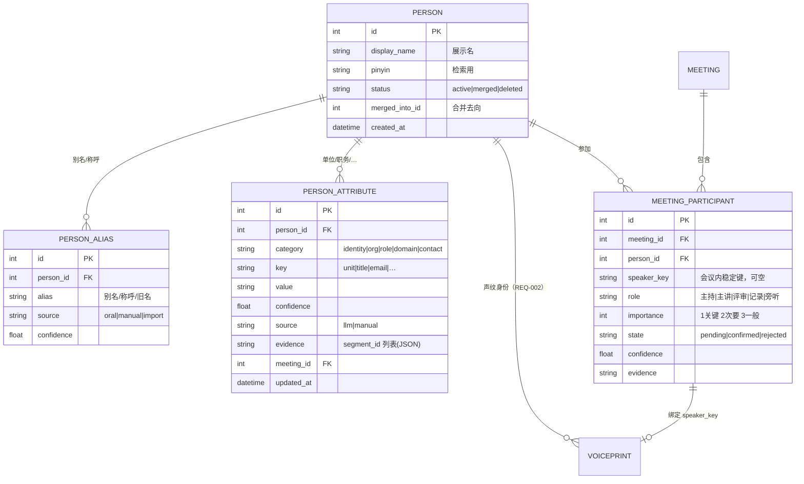

# REQ-001 会中参会人介绍抓取与人员本体

<!-- doc-governance: IM-REQ-001 -->
> 文档类型：需求；状态：草案；内容基准日期：2026-10-31；整理日期：2026-10-31。
> 需求正文仍待评审；10-31 阶段记录报告 P0 后端/前端已实现，P1 与验收不等于全部完成。
> 维护责任：待指派（iMeeting 文档维护者）。[台账](../README.md) · [维护规则](../governance/README.md)。

第1–2节的“现状”为需求起草时基线；核查后的实际实现、规格澄清与未完成项见[修复报告](../reports/2026-10-31-gap-fixes.md)。本次修订不改变需求仍待正式评审的状态。

| 项 | 内容 |
|---|---|
| 编号 | REQ-001 |
| 状态 | 草案（待评审） |
| 版本 | v0.1 |
| 关联需求 | REQ-002（声纹多场景模板库，人员实体与其共享身份主键） |
| 目标版本 | P0：抽取 + 人工确认 + 本体落库 + 说话人绑定；P1：别名合并、人员档案页 |

## 1. 背景

会议开场时，主持人或与会人几乎都会口头介绍在场人员（“这位是总体院的张主任”“我是十四所的李工，负责雷达总体”）。
这部分信息目前只被**一次性**解析成 `meeting.participants` 一个逗号字符串，既没有姓名与说话人的对应关系，也没有单位、职务等属性，且只在开场窗口结束时抽取一次，之后不再更新。

结果：

- 转写里仍然是「说话人 1/2/3」，纪要里出现的人名与说话人对不上；
- 同一批人在不同会议里重复出现，系统却记不住“张主任＝张三＝spk_xxx”；
- 后录入的参会人（中途进会、中途自我介绍）完全抓不到；
- 人员属性无处存放，导出、检索、纪要加权都只能靠 `SpeakerRole.importance` 一个维度。

## 2. 现状与差距

| 能力 | 现状 | 代码位置 | 差距 |
|---|---|---|---|
| 参会人抽取 | 开场窗口结束后调用一次 LLM，输出 `participants: ["姓名"]` | `backend/src/imeeting/meeting_meta.py` | 只取姓名；只跑一次；无证据、无置信度、无属性 |
| 参会人存储 | `Meeting.participants` 逗号字符串（≤1000 字符） | `backend/src/imeeting/models.py` | 无法表达人与人的差异、无法跨会议复用 |
| 说话人身份 | `Voiceprint.name` 兼作身份标签，`provisional` 按会议作用域生效 | `backend/src/imeeting/engine/speaker.py` | 姓名与声纹没有统一主键，改名靠字符串匹配 |
| 会中提示 | 顶部横幅提示“已识别会议信息”，可打开 `MeetingInfoEditor` 手改 | `frontend/src/pages/Meeting.tsx` | 只显示字符串，不能逐人确认/合并 |
| 本体 | 无 Person 实体 | — | 需要新建 |

## 3. 目标与非目标

### 3.1 目标

1. 会中**增量**捕获“介绍参会人”的语句，抽取姓名 + 人员属性；
2. 属性写入**人员数据本体**（Person / 别名 / 属性 / 会议参与关系），带来源证据；
3. 识别结果与说话人（`speaker_key`）建立绑定，让转写标签可以直接显示真实姓名；
4. 全流程人工可确认、可修改、可合并、可删除；未确认项不污染正式数据；
5. 抽取失败（LLM 不可用、超时、输出非法）不得影响转写与纪要。

### 3.2 非目标

- 不做通讯录/HR 系统对接（P2 再评估）；
- 不做声纹身份判定（那是 REQ-002 的职责，本需求只做“姓名↔人”的语义对齐）；
- 不采集联系方式等敏感字段（默认关闭，仅保留字段位）；
- 不做跨语言的姓名音译。

## 4. 用户场景

1. **开场介绍**：主持人开场 40 秒内介绍 4 位与会人。系统在开场窗口结束后立即抽取，横幅显示“已识别 4 位参会人（3 位待确认）”，用户逐条确认，转写中「说话人 2」随即变成「张三」。
2. **中途入会**：会议进行到 25 分钟，有人中途进来并自我介绍。系统检测到介绍句式后追加抽取，新增 1 位参会人，不打断记录。
3. **同名歧义**：两位都叫“李伟”，分别来自不同单位。系统标记为 `ambiguous`，提示用户用单位/职务区分，确认后各自独立成 Person。
4. **纠错**：LLM 把“王工”当成姓名。用户在横幅里把该条改为“王建国”，系统把它记为该 Person 的别名。

## 5. 人员本体设计



属性分类（P0 只落前两类，其余留字段）：

| category | key 示例 | 采集来源 | 备注 |
|---|---|---|---|
| identity | name、alias、pinyin | 口述 + 人工 | 必填 |
| org | unit、department、team | 口述 | 会议最常用区分维度 |
| role | title、meeting_role | 口述 + 推断 | “主任”“主持” |
| domain | expertise、project | 口述 | P1 |
| contact | phone、email、im | 仅人工 | 默认不自动采集 |

## 6. 功能需求

### FR-1 介绍语句捕获（P0）

| 编号 | 需求 | 验收点 |
|---|---|---|
| FR-1.1 | 开场窗口结束时触发一次抽取（沿用 `meeting.metadata_capture_minutes`，默认 3 分钟） | 窗口内转写 ≥ `meeting.metadata_min_chars`（30 字）时必定触发一次 |
| FR-1.2 | 会中增量触发：命中介绍句式且该片段为定稿（`is_final`）时，追加一次抽取 | 句式表：`我是/我叫/这位是/这是/给大家介绍/介绍一下/来自/负责` + 姓名候选；同一 `speaker_key` 5 分钟内不重复触发 |
| FR-1.3 | 会中每 N 分钟（`person.extract_interval_minutes`，默认 5，0=仅关闭周期扫描）兜底扫描新转写 | 开场、介绍句式与收尾仍受总开关/额度控制；关闭全部自动调用使用 `person.extract_enabled=false` |
| FR-1.4 | 手动“重新识别参会人”按钮 | 单场会议手动触发限流：≤1 次 / 30 秒，≤10 次 / 场 |
| FR-1.5 | 抽取只看“介绍上下文”，不做全文扫描 | 每次送入 LLM 的文本 ≤3000 字符：窗口内文本 + 命中句式前后各 2 句 |

### FR-2 LLM 结构化抽取（P0）

请求输出严格 JSON（`json_mode`），字段：

```json
{
  "people": [
    {
      "name": "张三",
      "aliases": ["张主任", "老张"],
      "attributes": [
        {"category": "org", "key": "unit", "value": "总体院"},
        {"category": "role", "key": "title", "value": "主任"}
      ],
      "meeting_role": "主持",
      "introduced_by_speaker": "说话人 1",
      "evidence": [{"segment_id": "s-…", "quote": "这位是总体院的张主任"}],
      "confidence": 0.86
    }
  ]
}
```

约束（服务端强校验，不满足即丢弃该条，不做“尽力解析”）：

| 编号 | 需求 |
|---|---|
| FR-2.1 | `name` 长度 2–32，必须出现在 evidence 的 `quote` 原文里（防幻觉）；否则整条丢弃 |
| FR-2.2 | `evidence.segment_id` 必须属于本场会议，且 `quote` 与片段文本有 ≥80% 的字符重合（去标点后子串匹配） |
| FR-2.3 | 属性值长度 ≤64，`category`/`key` 必须在白名单内，超白名单丢弃属性而非整条 |
| FR-2.4 | `confidence` 由 LLM 给出，服务端再与“证据完整度”相乘（有 evidence=×1.0，无=×0.5）；最终 <0.4 的记录进入 `pending` 且默认不展示，仅在“查看全部候选”里可见 |
| FR-2.5 | LLM 未配置/超时/非法 JSON 时：走规则兜底——正则 `(?:我是|我叫|这位是|这是|介绍一下)[，,]?\s*([\u4e00-\u9fa5]{2,4})` 抽姓名，`confidence=0.3`，`source=rule`，并在日志与本场审计中标注降级 |
| FR-2.6 | 单次调用计入 `LLMUsage`，`purpose="person_extract"`，便于成本看板归集 |

### FR-3 归一化与实体对齐（P0）

| 编号 | 需求 | 说明 |
|---|---|---|
| FR-3.1 | 姓名归一：去空格/全角转半角/去称谓后缀（“主任”“工”“老师”“总”） | 归一只用于匹配，展示名保留原样 |
| FR-3.2 | 对齐顺序：① 精确展示名 → ② 精确别名 → ③ 拼音相同且同单位 → ④ 同会议 `speaker_key` 已有绑定 → ⑤ 新建 Person | 每步命中即停止，避免过度合并 |
| FR-3.3 | 同名不同人：同名且单位/职务冲突 → `ambiguous=1`，两条均标 `pending`，提示用户“请用单位/职务区分” | 未确认前不自动合并 |
| FR-3.4 | 生成 `pinyin` 字段（声母+韵母，无声调）供检索与模糊匹配 | 无需引入新依赖：可用 `pypinyin`，或退化为字符 bigram |
| FR-3.5 | 每位 Person 的展示名唯一性：全局唯一约束只在 `status=active` 范围内生效 | 避免与已合并/已删除实体撞名 |

### FR-4 写入本体（P0）

| 编号 | 需求 |
|---|---|
| FR-4.1 | 幂等：同一 `(meeting_id, person_id, attribute category+key)` 重复抽取只更新时间与置信度，不新增行 |
| FR-4.2 | 所有属性写入必须带 `source`、`confidence`、`evidence`、`meeting_id`；无证据的人工修改标 `source=manual` |
| FR-4.3 | 写库前先写 `AuditLog`（`action="person_extract"` / `"person_confirm"` / `"person_merge"`），payload 含 person_id 与变更字段 |
| FR-4.4 | 兼容字段回写：抽取成功后按 `PERSON.display_name` 拼接回写 `Meeting.participants`（≤1000 字符，超出截断并记录日志），保证老前端与导出不受影响 |
| FR-4.5 | 事务边界：单场会议的一次抽取作为一个事务；失败整体回滚，不产生半条人员 |

### FR-5 与说话人绑定（P0）

| 编号 | 需求 |
|---|---|
| FR-5.1 | LLM 必须区分“介绍人”与“被介绍人”：`introduced_by_speaker` 记录介绍者，被介绍者不默认为介绍者 |
| FR-5.2 | 绑定来源优先级：人工指定 > LLM 明确指名（“张主任您先说”这类同句指代，P1）> 声纹相似（REQ-002）> 无绑定 |
| FR-5.3 | 绑定落 `MEETING_PARTICIPANT.speaker_key`；绑定后本场转写该 key 的标签展示为 `person.display_name` |
| FR-5.4 | 解绑/改绑必须回溯更新本场片段标签（复用现有 `relabel` 语义），并在审计中记录 |
| FR-5.5 | 一个 `speaker_key` 在同一会议内只能绑定一位 Person；冲突时以最后一次人工操作为准并提示 |

### FR-6 人工修订（P0）

| 编号 | 需求 |
|---|---|
| FR-6.1 | 横幅逐条展示：姓名 + 首要属性（单位·职务）+ 状态徽标（待确认/已确认/有歧义）+ 证据跳转 |
| FR-6.2 | 单条操作：确认、编辑（姓名/属性）、删除（`state=rejected`，不再出现在横幅，但保留审计） |
| FR-6.3 | 批量操作：全部确认；把两条候选合并为同一 Person；把一条候选拆分为新 Person |
| FR-6.4 | 编辑姓名触发别名逻辑：旧名写入 `PERSON_ALIAS`（`source=manual`），展示名更新 |
| FR-6.5 | 已确认（`confirmed`）的记录再次抽取时不得被自动改写，只允许人工再次修改 |
| FR-6.6 | 任何人工操作即时生效（`<500ms` 界面反馈），网络失败回滚并提示 |

### FR-7 查看与检索（P1）

- 人员档案页：按姓名/拼音/单位检索，显示其参与过的会议、别名、属性来源；
- 会议详情侧栏新增“参会人”分组（与现有 `SpeakerRolesPanel` 并列，不合并语义）；
- 导出（Markdown/Word/JSON）时按需带入单位/职务，可在导出对话框中关闭。

## 7. 数据模型草案

```text
person(id, owner_id, display_name, pinyin, status, merged_into_id, created_at, updated_at)
  UNIQUE(owner_id, display_name) WHERE status='active'   -- SQLite 用部分索引
person_alias(id, person_id, alias, source, confidence, created_at)
  UNIQUE(person_id, alias)
person_attribute(id, person_id, meeting_id, category, key, value, confidence, source, evidence, updated_at)
  UNIQUE(person_id, category, key)                        -- 幂等锚点
meeting_participant(id, meeting_id, person_id, speaker_key, role, importance, state, confidence, evidence, updated_at)
  UNIQUE(meeting_id, person_id)
  UNIQUE(meeting_id, speaker_key) WHERE speaker_key IS NOT NULL
```

迁移要求：

- 新增 Alembic 迁移一版（`2026xxxx_01_person_ontology.py`），仅建表与索引，不改老表；
- 历史回填：把现有 `meeting.participants` 按逗号切分，逐场建 Person（`source=import`，`confidence=0.5`，`state=pending`），一次性脚本 `scripts/backfill_persons.py`，可重复执行；
- 回填后仍以 `Meeting.participants` 为兼容展示字段，双向不一致时以本体为准并打出告警日志。

## 8. 接口草案

| 方法 | 路径 | 说明 |
|---|---|---|
| POST | `/api/v1/meetings/{id}/participants/extract` | 手动触发抽取；返回本次新增/更新的候选；`force` 不绕过服务端限流与在途保护 |
| GET | `/api/v1/meetings/{id}/participants` | 会议参会人列表（含 state、属性、speaker_key、evidence） |
| PATCH | `/api/v1/meetings/{id}/participants/{pid}` | 改姓名/属性/role/importance/state |
| POST | `/api/v1/meetings/{id}/participants/{pid}/bind` | 绑定 `speaker_key`（body `{speaker_key}`，`null` 表示解绑） |
| POST | `/api/v1/persons/{id}/merge` | body `{source_person_id}`，合并别名/属性/参会关系 |
| POST | `/api/v1/persons/{id}/split` | body `{alias 或 attribute 定位}`，拆出新的 Person（P1） |
| GET | `/api/v1/persons?q=&unit=` | 人员检索（P1） |

错误码约定：`404` 会议或人员不存在；`409` 同名歧义或 `speaker_key` 已绑定；`422` 参数非法；`429` 手动抽取触发限流。

## 9. 交互与提示

- 横幅文案：`已识别 5 位参会人 · 3 位待确认`，右侧按钮「逐条确认」「重新识别」「会议信息」；
- 待确认项默认**不**改动转写标签；确认后才替换为真实姓名；
- 歧义项用黄色徽标 + 提示“与已有‘李伟’同名，请补充单位后确认”；
- 所有提示均为非阻塞横幅，不弹模态框，不打断录音；
- 移动端（<lg）折叠为一行“已识别 N 位参会人”，点击展开抽屉。

## 10. 非功能需求

| 项 | 要求 |
|---|---|
| 时延 | 抽取接口 P95 ≤ 4s（单次 LLM 调用）；规则兜底 ≤ 200ms |
| 可靠性 | 抽取失败不影响转写、纪要与导出；连续失败 3 次后本场自动降级为规则兜底并提示 |
| 成本 | 每场自动抽取 ≤ 3 次（开场 1 + 增量 ≤2），手动 ≤10 次；每次 prompt ≤ 3000 字符 |
| 隐私 | 默认只存 name/unit/title；contact 类字段默认不采集；Person 删除为软删除并清空属性；导出口径可脱敏 |
| 可观测 | 指标：抽取次数、成功/降级比例、新增 Person 数、人工修改率、证据缺失丢弃数 |
| 兼容 | 老前端只读 `Meeting.participants` 时行为不变；API 均需 `get_current_user_or_anonymous` 语义一致 |

## 11. 验收标准

准备固定 fixture：一段 12 分钟会议转写（含开场 4 人介绍、1 个“老王”称呼、2 个同名“李伟”不同单位、1 处无姓名纯寒暄）。

| 编号 | 场景 | 通过条件 |
|---|---|---|
| AC-1 | 开场抽取 | 识别出 4 位介绍对象，姓名召回 ≥ 90%，且不得把寒暄句里的人名风格词当成姓名（误建 Person ≤ 1） |
| AC-2 | 属性正确性 | 单位/职务字段与 fixture 标注一致率 ≥ 80% |
| AC-3 | 幻觉防护 | 构造“LLM 返回原文没有的姓名”的 mock，该条必须被丢弃，且审计记录 `declined_reason=evidence_mismatch` |
| AC-4 | 幂等 | 对同一场会议连续执行抽取 3 次，`person` 与 `person_attribute` 行数不增长 |
| AC-5 | 别名 | 把“王工”改为“王建国”后，`王工` 出现在该 Person 的 `person_alias`，再次抽取命中同一 Person，不新建 |
| AC-6 | 同名歧义 | 两条“李伟”均置 `ambiguous`，未确认时不被合并；补充单位确认后拆分为两个 Person |
| AC-7 | 绑定 | 确认“张三”并绑定 `spk_a` 后，本场该 key 的片段标签变为“张三”，历史片段同步更新 |
| AC-8 | 降级 | 配置无 LLM key 时执行抽取，规则兜底给出姓名，接口 200，日志含 `degraded=true` |
| AC-9 | 兼容 | `GET /meetings/{id}` 的 `participants` 字符串与本体一致（顺序按重要程度、姓名） |
| AC-10 | 权限 | `REQUIRE_AUTH=1` 且未登录时接口 401；`=0` 时匿名可用，行为与现有接口一致 |

## 12. 分期与工作量

| 阶段 | 内容 | 预估 |
|---|---|---|
| P0 | 本体建表 + 抽取管线 + 横幅确认 + speaker 绑定 + 兼容回写 + 单测/集成测试 | 5–7 人日 |
| P1 | 人员档案页与检索、别名合并 UI、拆分、导出带属性 | 3–4 人日 |
| P2 | 通讯录导入、跨会议同名对齐策略调优、拼音检索优化 | 2–3 人日 |

## 13. 风险与未决问题

| 风险 | 应对 |
|---|---|
| LLM 编造姓名 | FR-2.1 强制 evidence 原文校验，宁缺勿错 |
| 同名不同人被合并 | 单位/职务冲突即 `ambiguous`，人工裁决；合并可撤销（保留 `merged_into` 反查） |
| 抽取次数过多导致成本上升 | 每场自动 ≤3 次 + 增量触发冷却 5 分钟 |
| 与 REQ-002 的身份冲突 | 本需求只做“姓名文本对齐”，身份判定以声纹人工确认为准，两者冲突时以人工为准并记录 |

未决问题（需产品/用户确认）：

1. 人员本体是**全局**（跨会议、跨用户）还是按 `owner_id` 隔离？草案按 `owner_id` 隔离（与现有 `voiceprint.owner_id` 一致）。
2. 是否需要“参会人人数上限”提示（例如介绍 20 人时是否只取前 N 位）？草案不设上限，按置信度排序展示前 8 条。
3. 音译/英文名是否纳入 P1？草案暂不纳入。

## 14. 会中加入（2026-10-31 补充）

需求补充：**会议一开始，识别到讲话人就自动进参会人**；同时支持会中**手工输入**与
**语音输入**加人；参会人在界面上只占一行。

### 14.1 自动加入

- 触发点：`engine/speaker.py::save_discovered` —— 实时聚类发现新的 `speaker_key`
  并落库待命名声纹后，调用 `persons.ensure_auto_participant`。
- 幂等：按 `(meeting_id, speaker_key)` 唯一，重复调用不会多行。
- 状态：`state=pending`、`confidence=0.3`，只表示「系统听出了这个声音」，不代表
  身份已确认；确认/改名后才把转写标签换成真实姓名。
- 命名规则（关键）：
  - **占位标签**（`说话人 N` / `参会人` 等前缀）：只在本场会议内复用，跨会议撞名
    时加后缀 `说话人 1（#8）`。不同会议的「说话人 1」绝不能并成同一个 person。
  - **真实姓名**（已登记声纹认出来的）：跨会议复用同一个人，这是人员本体应有的效果。
- 失败隔离：整段 `try/except`，自动加入失败不影响转写主流程。

### 14.2 手工与语音输入

- 接口：`POST /api/v1/meetings/{id}/participants`（`name` 必填，可选
  `speaker_key` / `role` / `attributes`），直接标为 `confirmed`；带 `speaker_key`
  时同时绑定并把本场转写标签回溯成该姓名。
- 语音输入：浏览器 `SpeechRecognition`（Chrome/Edge，需 localhost 或 HTTPS），识别
  结果**先落到输入框**，用户确认后回车提交——直接拿 ASR 结果建人员，念错一个音就会
  多出一个不存在的人。不支持时按钮隐藏，不报错。

### 14.3 界面（解决「占篇幅太多」）

- 默认只有一行：`参会人 N` + 姓名 chips（待确认的黄色、点一下即确认）+ 右侧四个
  图标（添加 / 语音 / 从介绍识别 / 展开收起）。
- 明细（改名、绑定声音键、删除、组织职务）收进展开区，最大高度 256px 滚动。
- 会中页面与会后详情页共用同一组件，`compact` 只控制外边距。

### 14.4 验收补充

| 用例 | 期望 |
|---|---|
| 同一 `speaker_key` 反复识别 | 参会人行数恒为 1 |
| 两场会都有「说话人 1」 | 两条 person，第二场带 `（#会议号）` 后缀 |
| 已登记声纹的「丁效」在两场会出现 | 同一条 person |
| 手工加「李四」并绑定 `spk_m` | 该段转写标签变「李四」，参会人 `confirmed` |
| 语音输入「张三」 | 输入框出现「张三」，回车后入列；取消时不产生任何人员 |
