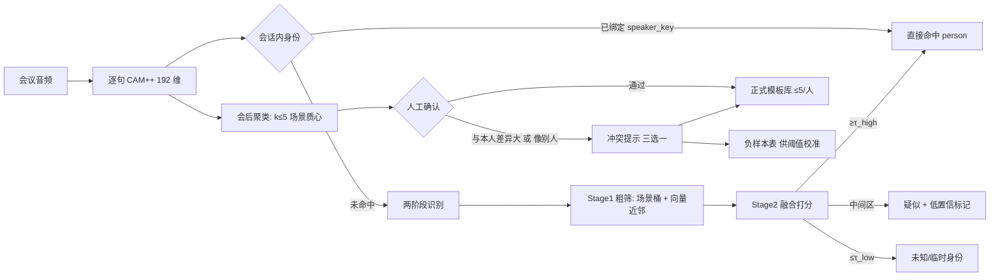

# REQ-002 多场景差异声纹库与多维声纹识别

<!-- doc-governance: IM-REQ-002 -->
> 文档类型：需求；状态：草案；内容基准日期：2026-10-31；整理日期：2026-10-31。
> 需求正文仍待评审；模板库/UI 已有阶段实现，实时模板匹配默认关闭，校准和 P1 待办保留。
> 维护责任：待指派（iMeeting 文档维护者）。[台账](../README.md) · [维护规则](../governance/README.md)。

| 项 | 内容 |
|---|---|
| 编号 | REQ-002 |
| 状态 | 草案（待评审） |
| 版本 | v0.1 |
| 关联需求 | REQ-001（人员本体：`person` 为身份主键，声纹归属其人） |
| 目标版本 | P0：模板表 + 会后聚类（≤5）+ 融合打分 + 人工确认冲突提示；P1：近邻索引、上下文/姓名先验、阈值校准脚本 |

## 1. 背景

当前每个说话人在库里只有**一条** 192 维质心（`voiceprint.embedding`），由开会时自动聚类的片段做滚动平均
（`old + emb` 归一化，见 `engine/speaker.save_discovered`），识别时把整条库线性扫一遍取最大余弦。

实测已经暴露两个硬问题：

1. **同一个人换个场景就不像自己**。同一个人的跨句相似度在真实录音里会低到 **0.54–0.58**
   （不同设备、不同距离、不同情绪、线上压缩音频都会拉低），而 `spk.enrolled_threshold` 默认 **0.68**，
   单条质心根本覆盖不了这种方差 —— 结果是要么认不出，要么被迫把阈值降到会认错人的水平。
2. **不同的人可能很像**。低阈值下相似声音会互相串，而当前**没有任何跨人冲突检测**：
   用户在转写里把「说话人 3」确认成“李伟”时，系统不会告诉用户“这个声纹其实更像王强（0.71）”。

同时，线性扫描在人数增长后是 O(N)：5000 人 × 5 模板 = 25000 条向量，逐条 `cosine()` 会拖慢实时定稿。

## 2. 现状与差距

| 能力 | 现状 | 代码位置 | 差距 |
|---|---|---|---|
| 模板 | 每人 1 条滚动平均质心 | `backend/src/imeeting/engine/speaker.py`（`save_discovered`） | 无法表达场景差异；新样本无条件污染旧质心 |
| 匹配 | 全库线性扫描，`best >= threshold` 即命中 | `match_enrolled` | O(N)；无粗筛、无 early-exit |
| 阈值 | `spk.enrolled_threshold=0.68`、疑似 0.58、仲裁余量 0.03、低置信 0.62 | `backend/src/imeeting/settings.py` | 单一阈值面对多场景方差，只能折中 |
| 会后处理 | 抽样 ≤5 段逐段回溯；小聚类合并（0.45 / 0.55） | `engine/speaker_reconcile.py`、`engine/speaker_merge.py` | 只做“合并/重标”，不产出场景化模板 |
| 人工确认 | 同名提交即确认（`speaker_source=manual`、`score=1.0`）；改名转正 | `api/http/routes/voiceprints.py::relabel_speaker` | **无冲突检测、无模板选择、无来源证据** |
| 人员归属 | 声纹按 `name` 字符串认身份 | 同上 | 与 REQ-001 的 `person_id` 尚未统一 |

## 3. 目标与非目标

### 3.1 目标

1. 每人维护 **≤5 条**场景化声纹模板，模板之间**必须差异化**（不是同一场景的重复采样）；
2. 识别采用**多维融合**：声纹相似度 + 场景匹配 + 有效语音 + 会话上下文，两阶段执行，兼顾速度与准确率；
3. 只有**人工确认**的样本进入正式模板库；自动发现的仍是 `provisional`，只在会议作用域内生效；
4. 用户确认声纹时，若“与本人原有声纹差异过大”**且/或**“与他人类似”，必须给出**可解释提示**并让用户三选一；
5. 性能预算：5000 人规模的库，单次识别 P95 ≤ 12ms（单核 CPU），确认评估 P95 ≤ 300ms；
6. 全本地离线可用，不引入外部服务。

### 3.2 非目标

- 不做 3D-Speaker / 更大的 SOTA 模型替换（继续用 CAM++ 192 维，模型名可配）；
- 不做情绪识别、年龄/性别推断等附属任务，只用其信号特征做场景分桶；
- 不做跨语种声纹迁移；
- P0 不引入 GPU 索引（ANN 放到 P1）。

## 4. 术语

| 术语 | 含义 |
|---|---|
| 模板（template） | 一条场景化的 192 维质心 + 场景标签 + 质量分；每人 ≤5 条 |
| 场景桶 | 设备/距离/噪声/发声状态四个维度的离散组合 |
| 正式库 | 人工确认过的模板集合，跨会议生效 |
| 临时身份（provisional） | 会议内自动聚类出来的未命名身份，只在 `meeting_id` 作用域匹配 |
| 冲突 | 新样本与本人模板差异大，或与他人的模板更接近 |
| 融合分 | 多维打分加权后的最终置信度 |

## 5. 方案总览



## 6. 功能需求

### FR-1 场景化模板与差异化约束（P0）

| 编号 | 需求 |
|---|---|
| FR-1.1 | 每位 Person/Voiceprint 最多 **5 条**模板；达到上限时新增必须走“替换”流程并记录 `superseded_by` |
| FR-1.2 | 单人模板两两余弦相似度必须 **≤ 0.92**（`spk.template_merge_sim`）；超过则合并为质量更高的那条，不做第二条 |
| FR-1.3 | 场景标签由**信号特征**推导，不允许让 LLM 猜（不可靠）：设备/信道来自采集参数；距离来自能量与 VAD；噪声来自 `segment.snr_db` / `noise_floor`；发声状态来自语速、能量方差、基频粗估 |
| FR-1.4 | 每条模板必须带：`quality`、`sample_ms`、`snr_db`、`source_meeting_id`、`source_segment_id`、`confirmed_by`/`confirmed_at` |
| FR-1.5 | 未人工确认的模板 `confirmed=0`，只能在该会议作用域参与匹配（与现有 `provisional` 语义一致） |

场景桶定义（离散化，P0 四维取并集作为标签）：

| 维度 | 桶 | 数据来源 |
|---|---|---|
| 设备/信道 device | `local_mic` / `room_array` / `phone` / `headset` / `online` | 采集设备标签、采样率、是否 AGC、是否 Opus 压缩 |
| 距离 distance | `near(<1m)` / `mid(1–3m)` / `far(>3m)` | `segment.audio_rms` + VAD 占空比 + 噪声底 |
| 噪声 noise | `quiet` / `reverb` / `noisy` | `snr_db`（>25 / 15–25 / <15）与 `noise_floor` 稳定性 |
| 发声 voice | `normal` / `fast` / `low` / `engaged` | 语速（字/秒）、能量方差、基频中位数相对个人均值偏移 |

### FR-2 会后聚类生成模板（P0）

触发：会议结束后（复用现有会后任务队列，与 `spk.post_meeting_reconcile_enabled` 同一时机）。

| 编号 | 需求 |
|---|---|
| FR-2.1 | 只取定稿片段，且满足 `speech_ms ≥ spk.min_speech_ms`（默认1200ms）、`snr_db ≥ spk.template_snr_floor`（当前默认0），按质量排序和每人取样上限控制；真实质量与准确率仍需校准 |
| FR-2.2 | 对同一 `speaker_key` 的向量做层次聚类（average linkage，cosine 距离，距离阈值 0.35 即相似度 0.65）；簇数 **k ≤ 5**，超出时用 farthest-first 保留 5 个中心簇 |
| FR-2.3 | 每簇质心 = 质量加权平均，权重 `w = min(1, speech_ms/3000) × snr_factor × (confirmed ? 1.2 : 1.0)` |
| FR-2.4 | 新质心与已有模板对齐：`cos ≥ 0.85` 视为同场景；按唯一来源的有效时长权重确定性聚合，同来源重放不叠加；自动未确认样本仅可对齐本场未确认候选，不改写正式模板 |
| FR-2.5 | 超过 5 条时按 farthest-first 保留覆盖度最高的一组；被淘汰模板置 `superseded_by`（保留可回滚，不物理删除） |
| FR-2.6 | 跨人暴露：任意两人的模板对 `cos ≥ 0.60` 时记为 `weak_pair`，写入校准报表（不阻塞） |
| FR-2.7 | 同一输入的重建应**幂等**：以会议+来源片段记录唯一贡献，不以场景标签作为来源唯一键；被替代证据重放不复活历史模板 |

### FR-3 多维识别（P0）

| 编号 | 需求 |
|---|---|
| FR-3.1 | Stage 0 上下文短路：本会话该 `speaker_key` 已绑定 person 且 `bound_confidence ≥ 0.9` 时直接命中，不做向量计算 |
| FR-3.2 | Stage 1 粗筛：模板数 ≥ `spk.stage1_min_templates`（默认 50）时，先按场景桶过滤（同桶优先、允许回退），再算向量点积；输出候选 ≤ 200（`spk.stage1_topk`） |
| FR-3.3 | Stage 2 融合打分：`score = w1*s_emb + w2*s_scene + w3*s_dur + w4*s_ctx`，默认 `w1=0.85, w2=0.05, w3=0.05, w4=0.05` |
| FR-3.4 | `s_emb` 取该人所有模板的最大余弦；`s_scene` 为场景桶匹配度（全匹配 1.0，一维不同 0.6，全不同 0）；`s_dur` 按有效语音时长归一（<1s 记 0）；`s_ctx` 为上一句同人（+1）与姓名提及（+1，P1） |
| FR-3.5 | 决策：`≥τ_high(0.68)` 命中；`≤τ_low(0.55)` 未知；中间区间输出“疑似 X”并置 `speaker_low_confidence=1`，前端可一键确认 |
| FR-3.6 | Early-exit：Stage 1 的最佳候选 `≥ τ_high + 0.06` 且与次优差 `≥ spk.arbitration_margin(0.03)` 时跳过 Stage 2 |
| FR-3.7 | 所有阈值进配置（见 §10），改动后无需重启（沿用现有 `get_config` 热读） |
| FR-3.8 | 兼容：`match_enrolled` 保留为薄封装（当库内每人仅 1 条模板时行为与旧实现逐位一致，用回归用例锁定） |

### FR-4 人工确认与冲突提示（P0，核心）

确认入口（复用现有交互，不新增“必须学会”的入口）：

- 转写里点击说话人标签改为真实姓名（`relabel` 改名）；
- 转写里点击「确认 xx%」（`relabel` 同名提交）；
- 声纹页/设置页的“确认样本”（新增接口）。

评估流程 `evaluate_confirm(person, sample_emb, context)`：

```text
s_self  = max over person.templates of cos(sample, t)        # 无模板 → None
s_other, other_person = max over other persons' templates     # 排除自己
diverge = s_self is None or s_self < 0.45                     # 与自己差异大
conflict = s_other >= 0.60 and s_other >= (s_self or 0) + 0.05 # 明显更像别人
```

| 编号 | 需求 |
|---|---|
| FR-4.1 | `diverge and conflict` → **高冲突**：弹出阻塞式确认（不可静默通过），必须三选一 |
| FR-4.2 | 仅 `diverge` 或仅 `conflict` → **建议核对**：非阻塞黄色提示，默认动作需二次点击确认 |
| FR-4.3 | 都不成立 → 静默确认，直接更新/新增模板并写审计 |
| FR-4.4 | 提示必须给出：`s_self`、`s_other`、对方姓名、样本来源（会议标题 + 时间 + 片段链接）、双方场景标签差异 |
| FR-4.5 | 三选一：①确认为本人（模板 <5 时新建；=5 时提示选择替换哪条，默认淘汰覆盖度最低）②其实是别人（选择目标人，或新建 Person）③取消 |
| FR-4.6 | 取消只记录 `cancelled`，不写模板。用户明确选择“其实是别人”后记录 `reassigned`，样本可归入授权范围内正确目标的正式模板，原错误身份模板不变；与 AC-5 一致。满槽时需明确替换项 |
| FR-4.7 | 对同一 `(person, other_person)` 组合连续两次选择“确认为本人”后，该组合标记 `tolerated`，后续同类不再弹高冲突（仍记录，可在设置里重置） |
| FR-4.8 | 入模板前必须过质量门槛：`speech_ms ≥ 1200`、`snr_db ≥ 10`、非静音；人工确认的样本 `quality=1.0` |
| FR-4.9 | 所有确认/重定向/替换写 `AuditLog`（`action`：`voiceprint_confirm` / `voiceprint_reassign` / `template_replace`），payload 含分数与选择结果 |
| FR-4.10 | 临时身份（provisional）确认同样走上述流程；确认后转正式身份，模板继承，`provisional=False` |

### FR-5 模板治理（P0/P1）

- 声纹页展示某人的模板列表：场景标签、质量、样本时长、来源会议、与其它模板相似度热力图；
- 支持手动停用/启用单条模板（`disabled`）、合并两条模板、手动选择主模板（`pinned`）；
- 删除 Person 时解除声纹关联并保留声纹/模板（已实现，2026-10-31 决策）：生物特征是独立数据，删档案不等于同意销毁；要销毁必须走声纹删除接口。此处原措辞为“级联删除模板与冲突记录”，与实现和隐私预期冲突，按上述规则修订。
- P1：跨设备“重新注册”向导（引导用户在新场景说 30 秒，直接生成第 N 条模板）。

## 7. 数据模型草案

```text
voiceprint（保留为聚合头，字段不变）
  id, owner_id, name, provisional, meeting_id, speaker_key, disabled, quality_score, ...
  新增：person_id(可空，P1 与 REQ-001 对接), template_count(冗余计数)

voiceprint_template
  id PK
  voiceprint_id  FK -> voiceprint.id   索引
  embedding      BLOB                    -- 192 × float32，L2 归一化后存储
  dim            INT   default 192
  scenario_device / scenario_distance / scenario_noise / scenario_voice   TEXT
  quality        FLOAT                   -- 0..1
  sample_ms      INT
  snr_db         FLOAT
  source_meeting_id   INT
  source_segment_id   TEXT
  confirmed      BOOL default 0
  confirmed_by / confirmed_at
  superseded_by  INT  NULL               -- 被替换时指向新模板
  pinned         BOOL default 0          -- 主模板；每人最多一条（SQLite 部分唯一索引）
  created_at / updated_at

voiceprint_conflict
  id PK
  voiceprint_id        FK    索引
  meeting_id / segment_id
  sample_embedding     BLOB                 -- 仅保留向量，不留音频
  self_score           FLOAT NULL
  other_voiceprint_id  FK NULL
  other_score          FLOAT NULL
  reason               TEXT  -- diverge | conflict | both
  status               TEXT  -- pending|accepted|reassigned|cancelled|tolerated
  decided_by / decided_at
  created_at
```

约束与迁移：

- ≤5 上限：服务层校验 + DB 层部分唯一索引无法表达“计数”，因此加**触发器**或在 `voiceprint_template` 上建 `(voiceprint_id, active)` 唯一槽位（`slot 0..4`）——建议 `slot INT` + `UNIQUE(voiceprint_id, slot)`，替换即改 slot，天然限 5；
- 迁移 `2026xxxx_02_voiceprint_templates.py`：把现有每条 `voiceprint.embedding` 导入为 `slot=0` 的模板（`scenario_*=unknown`，`quality=quality_score`，`confirmed = NOT provisional`），`voiceprint.name` 等字段不动；
- 回滚：保留 `voiceprint.embedding` 至 P1 结束，识别优先读模板、读不到回退旧字段（双写期）。

## 8. 接口草案

| 方法 | 路径 | 说明 |
|---|---|---|
| GET | `/api/v1/voiceprints/{id}/templates` | 模板列表（场景标签、质量、来源、相似度矩阵） |
| POST | `/api/v1/voiceprints/{id}/templates` | 手动新增（body 含 wav 或 segment_id + 场景标签） |
| PATCH | `/api/v1/voiceprints/{id}/templates/{tid}` | 停用/启用、改场景标签、设为主模板 |
| POST | `/api/v1/voiceprints/{id}/templates/{tid}/replace` | 用新样本替换该 slot |
| POST | `/api/v1/voiceprints/confirm-sample` | 核心：body `{voiceprint_id, segment_id 或 wav, decision?: "self"|"other"|"cancel", other_voiceprint_id?}`；返回 `{conflict: bool, self_score, other: {id,name,score}, allowed_actions}` |
| GET | `/api/v1/voiceprints/conflicts?status=pending` | 待处理冲突列表 |
| POST | `/api/v1/voiceprints/conflicts/{id}/decide` | body `{action: "accept"|"reassign"|"cancel", target_voiceprint_id?, replace_slot?}` |
| POST | `/api/v1/voiceprints/{id}/merge` | 合并两个声纹（模板合并后仍受 ≤5 约束） |

错误码：`409` 模板已满且未指定替换槽位；`409` 目标声纹已被合并；`422` 样本质量不达标（返回具体原因：时长/信噪/静音）；`404` 模板或声纹不存在。

## 9. 配置项（新增）

| key | 默认 | 说明 |
|---|---|---|
| `spk.template_max` | 5 | 每人模板上限 |
| `spk.template_merge_sim` | 0.92 | 同人模板合并阈值 |
| `spk.template_align_sim` | 0.85 | 新质心与旧模板“同场景”对齐阈值 |
| `spk.self_min_sim` | 0.45 | “与本人差异过大”判据 |
| `spk.conflict_sim` | 0.60 | “与别人更像”判据 |
| `spk.conflict_margin` | 0.05 | s_other 必须超过 s_self 的最小差值 |
| `spk.fuse_w_emb/scene/dur/ctx` | 0.85/0.05/0.05/0.05 | 融合权重 |
| `spk.stage1_min_templates` | 50 | 启用粗筛的最小库规模 |
| `spk.stage1_topk` | 200 | 粗筛候选数 |
| `spk.ann_enabled` | false | P1 近邻索引开关 |
| `spk.template_sample_max` | 32 | 会后聚类时每人取样上限（按时长与信噪比排序取优） |
| `spk.template_snr_floor` | 0 | 入模信噪比硬下限；0 = 不过滤（见下方实测说明） |
| `spk.template_cluster_sim` | 0.65 | 聚类合并相似度阈值 |
| `spk.template_rebuild_enabled` | true | 会议收尾后自动跑模板聚类 |

> 取样为什么要改成「排序取前 N」：浏览器麦克风实录的 `snr_db` 中位数只有 6–8 dB（会议 #1 的 644 段里仅 25 段达到 10，会议 #7 的 152 段里 0 段），早期实现写的 `snr >= 10` 硬门槛会把真实会议的所有片段滤光，`rebuild` 返回 `skipped=1`、模板一条都建不出来。现在信噪比只作为质量权重，硬下限默认关闭，并加上 `template_sample_max` 控制耗时（实测本项目 CPU 约 1.4 s/段）。

## 10. 交互设计

- **确认弹窗（高冲突）**：标题“这个声纹可能不是张三”，正文给出两个分数条：
  `与张三的模板 0.38（差异较大）` / `与王强 0.71（更像）`，附样本来源“10:24 会议《…》第 3 句”+ 试听按钮；底部三按钮：`确认为张三` / `其实是王强（或其他人…）` / `取消`。
- **建议核对（中风险）**：同一卡片以黄色内联提示出现在说话人标签旁，默认不阻塞。
- **模板管理**：声纹页每人一行展开 5 个 slot，显示场景徽标（设备/距离/噪声/发声）、质量条、相似度热力图；空格可手动“补录”。
- **替换选择**：模板满 5 时，“确认为本人”后弹出 5 个 slot 让用户选择替换哪个，默认选中“覆盖度最低”并说明理由（“这条是 3 个月前的手机录音，与本次场景重复度 0.88”）。
- 所有提示文案不出现“阈值”“余弦”等术语；分数以百分比 + 定性描述呈现。

## 11. 非功能需求

| 项 | 要求 |
|---|---|
| 时延 | 识别 P50 ≤ 3ms、P95 ≤ 12ms（25000 条模板，单核 CPU）；`confirm-sample` P95 ≤ 300ms |
| 内存 | 模板库常驻 ≤ 40MB（25000 × 192 × 4B ≈ 19MB，含索引与副本）；缓存策略沿用 `_CACHE` 的 10s TTL + 变更即失效 |
| 可靠性 | 声纹服务不可用/模型未加载时，识别降级为“未知”，不影响转写与纪要 |
| 幂等 | 会后聚类对同一会议重复执行结果一致；确认接口重复提交同一样本不产生重复模板 |
| 隐私 | 只存向量，不存原始音频；冲突记录同样只存向量；删除 Person/声纹即级联删除模板与冲突记录；导出不含向量 |
| 可观测 | 指标：识别延迟分位数、命中率、疑似比例、冲突提示次数/接受率/取消率、模板分布（0–5 条的人数）、`weak_pair` 数量 |
| 离线 | 全本地计算，无外部依赖 |

## 12. 验收标准

准备三组数据：①同一人 5 场景各 3 段（近场/远场/耳机/手机/情绪）；②两个声音相近的人各 3 段；③5000 人的合成库（真实向量 + 高斯扰动）。

| 编号 | 场景 | 通过条件 |
|---|---|---|
| AC-1 | 差异化模板 | 同一人 5 场景确认后模板数 ≤5，两两余弦 ≤0.92，Top-1 识别率 ≥95% |
| AC-2 | 上限与替换 | 第 6 次确认必须提示替换；替换后总数为 5，旧模板 `superseded_by` 非空且可回滚 |
| AC-3 | 高冲突提示 | 对②中 A 的样本确认成 B 时，100% 触发高冲突，且提示里的“更像的人”必须是 A |
| AC-4 | 同人误报 | 同一人跨场景样本（s_self≈0.55 ≥0.45）不得触发高冲突，最多黄色建议；误报率 ≤10% |
| AC-5 | 重定向 | 选择“其实是别人”后，样本归入目标声纹，原声纹模板数不变，审计有记录 |
| AC-6 | 取消不污染 | 取消后模板数与识别结果均不变，`voiceprint_conflict.status=cancelled` |
| AC-7 | 性能 | ③库上识别 P95 ≤12ms；`confirm-sample` P95 ≤300ms（用脚本压测，结果贴进 PR） |
| AC-8 | 兼容回归 | 迁移后历史会议回放，Top-1 不得低于迁移前（逐条对比，允许 ±0.5% 抖动） |
| AC-9 | 临时身份 | `provisional` 声纹只在同会议命中；确认后跨会议生效，模板继承正确 |
| AC-10 | 离线与降级 | 模型未加载时识别返回未知且接口 200；断网全链路可用 |
| AC-11 | ≤5 硬约束 | 绕过服务层直接写库（模拟脚本）时，DB 层 `UNIQUE(voiceprint_id, slot)` 必须拒绝第 6 条 |

## 13. 度量与监控

| 指标 | 目标 |
|---|---|
| Top-1 准确率（分场景分层） | ≥95%（近场）/ ≥85%（远场、线上） |
| EER | ≤5%（P0 基线用现有数据回归） |
| FAR / FRR | 分别 ≤3% / ≤8%（按场景分层汇报） |
| 冲突提示精确率 | ≥85%（提示为“像别人”且人工确认确实为别人的比例） |
| 模板覆盖度 | 每人平均 ≥2.5 个不同场景桶 |
| 识别延迟 | P95 ≤12ms |

## 14. 分期与工作量

| 阶段 | 内容 | 预估 |
|---|---|---|
| P0 | 模板表与迁移、会后聚类（≤5）、融合打分（声纹+场景+时长）、确认冲突提示三选一、审计、单测与压测 | 8–10 人日 |
| P1 | 近邻/分桶索引、上下文与姓名先验、阈值校准脚本（FAR/FRR 曲线）、模板管理 UI（热力图/替换） | 5–6 人日 |
| P2 | 跨设备重注册向导、`person_id` 与 REQ-001 全量对接、情绪/健康特征探索 | 4–5 人日 |

## 15. 风险与未决问题

| 风险 | 应对 |
|---|---|
| 192 维 CAM++ 在远场/压缩音频下退化（实测同人 0.54–0.58） | 场景分层阈值 + 模板差异化；远场样本单独定标，必要时对远场启用更宽松的 τ_high |
| ≤5 上限与长期覆盖矛盾 | 场景桶收敛到 4 维离散；淘汰走 farthest-first 保覆盖；被淘汰模板可回滚 |
| 相似人误判导致“认错人” | 冲突只提示不自动改判；高冲突必须人工三选一；负样本用于校准 |
| 用户被频繁打扰 | 同一组合 `tolerated` 机制；中风险提示非阻塞；可在设置关闭提示（仍记录） |
| 向量即生物特征，泄露风险 | 只存向量、可加密静态存储（P1 评估 SQLCipher）、删除即级联；导出不含向量 |
| 计算成本上升 | 两阶段 + early-exit；粗筛仅在库大时启用；矩阵点积用 numpy 单次批量 |

未决问题（需确认）：

1. 模板是否跨 `owner_id` 共享？草案按 `owner_id` 隔离（与现有 `voiceprint.owner_id` 一致），团队共用需 P2 评估。
2. 冲突提示是否允许管理员批量处理？草案 P0 仅逐条。
3. 是否需要“声纹试听”能力（原音回放）？受隐私约束，草案只提供片段跳转（若已保存音频）。
4. `person_id` 与 `voiceprint.id` 的合并时机：草案在 REQ-001 落地时同步迁移，两需求共用同一身份主键。
